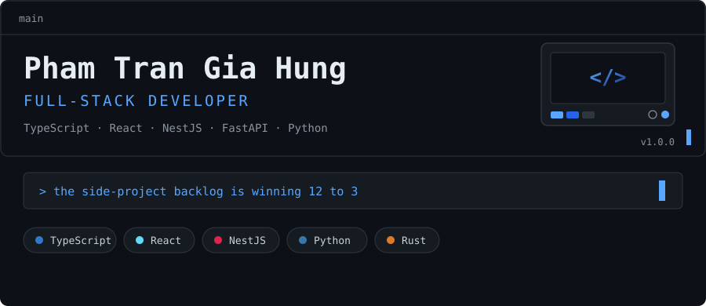

### Hello World / Xin chào!  

- I'm **Phạm Trần Gia Hưng (Hung1510)**, a Software Engineering graduate at <a href="https://eiu.edu.vn/">Eastern International University</a>, Vietnam 🇻🇳
- I'm currently building **full-stack apps** and exploring **AI / Computer Vision**
- Currently learning **Rust** and **Machine Learning**
- Ask me about **web dev**, **game dev (UE5)**, **gacha game (Arknights, Wuthering Wave)** or **Warhammer 40K** lore
- Current interests: Painting WH40K minis, and simping for Aemeath and Shorekeeper from WuWa

 

---

### Selected projects

[**Eco-Faker**](https://github.com/Hung1510/Eco-Faker) — Stateful, relationally-consistent fake e-commerce data generator. CLI, MCP server, REST/GraphQL/tRPC/MSW adapters, analytics, fraud sim, OTel traces, and more.

[**Code-Navigator**](https://github.com/Hung1510/Code-Navigator) — Ask your codebase in plain language: local RAG + code intelligence with hybrid retrieval, cross-encoder reranking, and a tree-sitter call graph.

[**Somnium-Weaver**](https://github.com/Hung1510/Somnium-Weaver) — Transparent desktop overlay that weaves PC live vitals into particle tapestry — WPF/.NET 8, SkiaSharp, audio-reactive FFT, and an ONNX autoencoder.

[**Tethys**](https://github.com/Hung1510/Tethys) — Native Wuthering Waves echo optimizer + scanner. Reads your echoes from the screen with OCR and computes the mathematically good build.

[**Capstone_Project_Quizz**](https://github.com/Hung1510/Capstone_Project_Quizz) — IT interview prep and practice quiz platform. Spring Boot + MongoDB backend, React + Vite frontend, deployed on Vercel and Render.

[**Portfolio**](https://github.com/Hung1510/Portfolio) — This site. React, Vite, and TypeScript, with a bilingual dev-log and per-project detail pages.

Feel free to connect!   
<a target="_blank" href="https://giahung-portfolio.vercel.app/"></img></a>
<a target="_blank" href="https://www.linkedin.com/in/h%C6%B0ng-undefined-115b17332/"></img></a>
<a target="_blank" href="mailto:giahung1510200519@gmail.com"></img></a>

